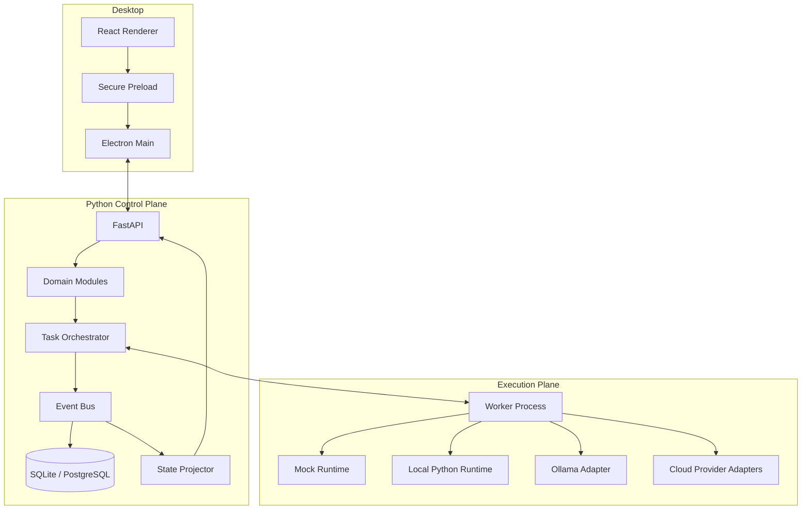

# ARCHITECTURE — Orchestra Studio

**Version:** 0.1  
**Status:** Baseline proposal

## 1. System goals

Orchestra Studio manages AI organizations through a desktop Control Center. It must support local-first operation, multiple runtimes, observable execution, human approvals and a future hybrid deployment model.

Non-goals for the first release:
- Microservices.
- Multi-tenant public SaaS.
- Fully autonomous external actions without approval.
- A general-purpose visual workflow programming language.
- Showing model chain-of-thought.

## 2. High-level architecture



The initial implementation may run desktop, backend and worker on one machine. Keep process boundaries explicit even when deployed together.

## 3. Architectural style

Use a **Modular Monolith + Worker Process**.

- Modular monolith keeps domain logic cohesive and deployment simple.
- Worker process isolates execution, timeouts and potentially untrusted tools.
- Modules communicate through explicit service interfaces and contracts.
- Do not split into microservices until operational evidence justifies it.

## 4. Core modules and responsibilities

| Module | Responsibility | Must not own |
|---|---|---|
| Companies | Company lifecycle and settings | Agent execution |
| Organization | Departments, reporting lines, org graph | Runtime internals |
| Agents | Agent identity, versions, configuration | Run process lifetime |
| Tasks | Task lifecycle, assignment, dependencies | Provider-specific prompts |
| Orchestrator | Scheduling, dispatch, retries, coordination | UI state |
| Runtime Manager | Adapter registry, capability checks | Business permissions |
| Events | Append-only event recording and delivery | UI rendering |
| Approvals | Approval policy and decisions | Runtime-specific execution |
| Knowledge | Knowledge items, lessons, retrieval metadata | Hidden model reasoning |
| Artifacts | File metadata, storage references and access | Large file bytes in events |
| Metrics | Operational and business measurements | Invented performance scores |
| Tool Gateway | Tool authorization and execution boundary | Self-granted Agent permissions |

## 5. Desktop boundaries

Renderer:
- React + TypeScript.
- Uses REST for commands/queries and SSE for event updates.
- Uses TanStack Query for server state and Zustand for local UI state.
- Must not access Node APIs or the filesystem directly.

Electron:
- Main process owns window lifecycle and tightly scoped native capabilities.
- Preload exposes a small, typed API.
- Validate IPC sender and arguments.
- Do not expose generic `ipcRenderer`, `shell`, `fs` or unrestricted process execution.

Backend:
- Source of truth for domain state.
- Validates commands, permissions and transitions.
- Publishes events after successful domain operations.

## 6. Suggested repository layout

```text
orchestra-studio/
├── apps/
│   ├── desktop/
│   │   ├── electron/
│   │   │   ├── main.ts
│   │   │   ├── preload.ts
│   │   │   └── ipc/
│   │   └── renderer/src/
│   │       ├── app/
│   │       ├── components/
│   │       ├── layouts/
│   │       ├── features/
│   │       │   ├── dashboard/
│   │       │   ├── companies/
│   │       │   ├── organization/
│   │       │   ├── agents/
│   │       │   ├── tasks/
│   │       │   ├── approvals/
│   │       │   ├── knowledge/
│   │       │   └── analytics/
│   │       ├── stores/
│   │       ├── services/
│   │       └── types/
│   └── backend/
│       ├── app/
│       │   ├── main.py
│       │   ├── core/
│       │   ├── modules/
│       │   ├── runtime/
│       │   │   ├── interfaces/
│       │   │   ├── registry.py
│       │   │   ├── mock/
│       │   │   ├── local_python/
│       │   │   ├── ollama/
│       │   │   ├── claude/
│       │   │   └── openai/
│       │   ├── workers/
│       │   ├── tool_gateway/
│       │   ├── event_bus/
│       │   └── api/
│       ├── migrations/
│       ├── tests/
│       └── pyproject.toml
├── packages/
│   ├── contracts/
│   │   ├── events/
│   │   ├── api/
│   │   └── schemas/
│   ├── shared-types/
│   └── ui-kit/
├── templates/
│   ├── company/
│   ├── department/
│   ├── agent/
│   └── skill/
├── data/                 # runtime only; never commit secrets/user data
├── docs/
│   ├── adr/
│   └── ...
├── scripts/
└── tests/
```

This is a target structure, not permission to create every folder in P0. Create only what the active task needs.

## 7. Dashboard information architecture

Primary shell:
- Left sidebar: company switcher, departments and modules.
- Center workspace: selected view.
- Right inspector: selected Agent, Task, Run or Artifact.
- Bottom activity console: event stream and execution trace.

The inspector and console should be collapsible. Avoid turning the interface into a chat-only product.

Core views:
1. Company Overview — organization health, active work, pending approvals, recent activity.
2. Department Overview — agents, tasks and department-level metrics.
3. Agent Detail — role, version, skills, tools, permissions, recent runs.
4. Organization Builder — graph-based departments and reporting relationships.
5. Agent Control Room — agent roster, execution graph, selected-run inspector, event console.
6. Tasks — queue, assignments, dependencies, status and artifacts.
7. Approvals — pending requests, policy context and decision audit.
8. Knowledge — knowledge items and lessons with provenance.
9. Analytics — operational metrics, cost and reliability when data is available.

## 8. State and execution model

An Agent is a configured identity, not a permanently running process. Each execution creates an Agent Run.

Suggested Agent states: `draft`, `active`, `inactive`, `archived`.

Suggested Run states: `queued`, `starting`, `running`, `waiting_approval`, `paused`, `completed`, `failed`, `cancel_requested`, `cancelled`, `timed_out`.

State transitions must be validated in backend domain services. A UI action is a command request, not proof that the transition succeeded.

## 9. Data flow

1. User issues a command from the UI.
2. Backend authenticates/authorizes and validates it.
3. Domain service changes state within a transaction.
4. An event is persisted using a transactional strategy.
5. Orchestrator dispatches work to an eligible worker/runtime.
6. Worker emits normalized execution events.
7. Event store persists them; projector updates read models.
8. SSE delivers authorized updates to the UI.
9. UI refreshes relevant queries and renders the observed state.

Avoid a dual-write gap between domain state and event persistence. For the initial version, use a transactional outbox or an equivalent transactionally safe design where needed.

## 10. Persistence and deployment evolution

Local:
- SQLite database.
- Local artifact directory.
- Local worker process.
- Credentials stored using OS-backed secure storage where practical.

Hybrid later:
- Control Plane: FastAPI + PostgreSQL.
- Workers: registered processes on user PCs or servers.
- Workers connect outbound over authenticated HTTPS.
- Workers receive assigned jobs and send events/artifact references.
- Workers do not connect directly to the control-plane database.

## 11. Architecture constraints

- No business logic in React components.
- No provider-specific data model in core domain entities.
- No direct database writes from runtime adapters.
- No large binary payloads in events.
- No hidden auto-approval.
- No implicit permission escalation.
- No microservices in P0.
- Record architecture-affecting changes in ADRs.
