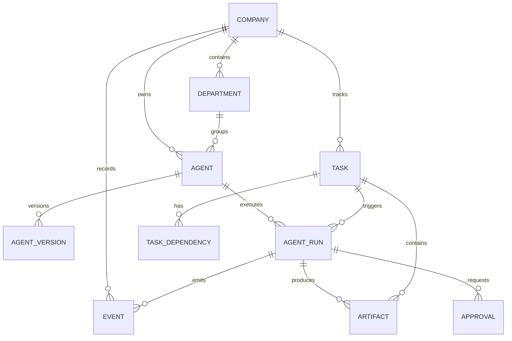

# DATABASE — Orchestra Studio

**Version:** 0.1  
**Status:** Initial logical model; refine through migrations and ADRs.

## 1. Persistence strategy

Start with SQLite for single-user local operation. Use SQLAlchemy 2.x and Alembic migrations.

Design the domain layer so PostgreSQL can be adopted when remote workers, concurrent users or server deployment require it. Avoid SQLite-only SQL and avoid relying on SQLite's concurrency characteristics as a system-wide guarantee.

Operational rules:
- Keep write transactions short.
- Configure busy timeout and sensible connection handling.
- Use one controlled persistence boundary.
- Do not let Agent runtimes write directly to the database.
- Store timestamps in UTC.
- Use UUIDs as stable identifiers.
- Store large files outside relational rows; keep metadata and references in the database.

## 2. Logical entities

### Company and organization

`companies`
- `id` UUID PK
- `name`
- `description`
- `status`
- `settings_json`
- `created_at`, `updated_at`

`departments`
- `id` UUID PK
- `company_id` FK
- `parent_department_id` nullable FK
- `name`, `description`
- `status`
- `created_at`, `updated_at`

### Agent definitions

`agents`
- `id` UUID PK
- `company_id` FK
- `department_id` nullable FK
- `reports_to_agent_id` nullable FK
- `name`, `role`, `description`
- `status` (`draft`, `active`, `inactive`, `archived`)
- `current_version_id` nullable FK
- `created_at`, `updated_at`

`agent_versions`
- `id` UUID PK
- `agent_id` FK
- `version_number`
- `definition_json` (provider-neutral role/instructions/config)
- `runtime_preference_json` (runtime ID and non-secret settings)
- `created_by`, `created_at`
- unique (`agent_id`, `version_number`)

Do not store raw API keys in these tables. Use credential references.

### Skills and tools

`skills`
- `id` UUID PK
- `company_id` nullable FK (null may represent built-in/shared template)
- `name`, `description`, `version`
- `definition_json`
- `created_at`, `updated_at`

`agent_skills`
- `agent_id` FK
- `skill_id` FK
- optional pinned version
- composite PK

`tools`
- `id` UUID PK
- `company_id` nullable FK
- `name`, `description`
- `input_schema_json`
- `permission_level`
- `policy_json`
- `enabled`
- `created_at`, `updated_at`

`agent_tools`
- `agent_id` FK
- `tool_id` FK
- `configuration_json`
- composite PK

### Tasks and execution

`tasks`
- `id` UUID PK
- `company_id` FK
- `parent_task_id` nullable FK
- `assigned_agent_id` nullable FK
- `created_by`
- `title`, `description`
- `status`, `priority`
- `due_at` nullable
- `created_at`, `updated_at`, `completed_at` nullable

`task_dependencies`
- `task_id` FK
- `depends_on_task_id` FK
- `dependency_type`
- composite PK (`task_id`, `depends_on_task_id`)

`agent_runs`
- `id` UUID PK
- `company_id` FK
- `agent_id` FK
- `agent_version_id` FK
- `task_id` nullable FK
- `runtime_id`
- `worker_id` nullable
- `status`
- `started_at`, `finished_at` nullable
- `input_ref` or bounded input metadata
- `result_summary` nullable
- `error_code`, `error_summary` nullable
- `usage_json` nullable

A run records one execution attempt. Retries should be represented explicitly, either as separate runs linked by a retry/group identifier or by a clearly defined attempt model. Do not overwrite prior run history.

### Events and approvals

`events`
- `id` UUID PK
- `company_id` FK
- `run_id` nullable FK
- `sequence` integer
- `event_type`
- `schema_version`
- `occurred_at` UTC
- `source`
- `correlation_id`, `causation_id` nullable
- `idempotency_key` nullable
- `payload_json`
- unique sequence scope, e.g. (`company_id`, `sequence`) or a documented stream scope

Events are append-only. Define retention and indexing policy before event volume grows.

`approvals`
- `id` UUID PK
- `company_id` FK
- `run_id` nullable FK
- `task_id` nullable FK
- `requested_by_agent_id` nullable FK
- `action_type`
- `request_json`
- `status` (`pending`, `approved`, `rejected`, `expired`, `cancelled`)
- `decided_by`, `decision_note`
- `created_at`, `decided_at` nullable

An Agent cannot approve its own privileged action unless a future policy explicitly defines a safe delegated approval model.

### Artifacts, knowledge and metrics

`artifacts`
- `id` UUID PK
- `company_id` FK
- `task_id`, `run_id` nullable FK
- `name`, `mime_type`, `size_bytes`
- `storage_uri`
- `checksum`
- `created_at`
- `access_policy_json`

`knowledge_items`
- `id` UUID PK
- `company_id` FK
- `title`, `content_ref` or bounded content
- `kind`, `source_type`, `source_id`
- `version`, `created_at`, `updated_at`
- `metadata_json`

`lessons`
- `id` UUID PK
- `company_id` FK
- `title`, `lesson`
- `source_task_id`, `source_run_id` nullable
- `confidence` nullable (only if defined and justified)
- `created_at`, `review_status`

`metrics`
- `id` UUID PK
- `company_id` FK
- `agent_id`, `department_id`, `task_id`, `run_id` nullable
- `metric_name`, `metric_value`, `unit`
- `period_start`, `period_end`
- `source_event_id` nullable
- `recorded_at`

### Credentials and workers (later phase)

`credential_refs`
- `id` UUID PK
- `provider`, `label`, `secret_store_ref`
- `created_at`, `updated_at`
- Never store secret value in this table.

`workers`
- `id` UUID PK
- `display_name`, `status`, `capabilities_json`
- `registered_at`, `last_seen_at`
- `credential_ref` / identity metadata

These may be deferred until runtime adapters and remote workers are implemented.

## 3. Relationships

## 4. Indexing and integrity

Initial useful indexes:
- `agents(company_id, department_id, status)`
- `tasks(company_id, status, priority, created_at)`
- `tasks(assigned_agent_id, status)`
- `agent_runs(agent_id, started_at)`
- `agent_runs(task_id, started_at)`
- `events(company_id, sequence)`
- `events(run_id, sequence)`
- `approvals(company_id, status, created_at)`
- `artifacts(task_id, created_at)`

Enforce:
- Foreign keys.
- Unique agent version number per Agent.
- Valid status transitions in domain services.
- Idempotency for commands that may be retried.
- No cascading deletion of audit events or completed run history without an explicit retention policy.

## 5. Deletion and lifecycle

Prefer archive/soft-delete for core entities where history matters. Deletion behavior must be explicit:
- Archiving an Agent does not delete its runs.
- Deleting a Task must not silently erase artifacts or audit events.
- Credential revocation must invalidate future use without rewriting historical events.
- Retention and export policies require a later product decision.

## 6. Migration policy

- Every schema change uses Alembic.
- Migrations must be reversible where practical; otherwise document why not.
- Test migration from an empty database and from the previous supported schema.
- Do not modify an already released migration to repair data; create a new migration.
- Add an ADR for changes to core entity relationships or event persistence semantics.
