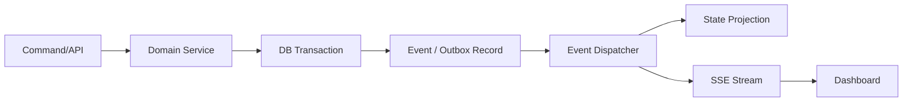

# EVENTS — Orchestra Studio

**Version:** 0.1  
**Status:** Baseline contract

## 1. Concepts

- **Command**: a request to perform an action.
- **Event**: an immutable fact that an action occurred.
- **State**: the current domain representation, updated by validated domain operations and/or projections.

Example:
- Command: `pause_run`.
- Event: `agent.run.pause_requested`.
- Event after runtime confirmation: `agent.run.paused`.
- State: `AgentRun.status = paused`.

Do not emit `agent.run.paused` merely because the user clicked Pause. The runtime must confirm the pause or the system must clearly report that pause is unsupported/pending.

## 2. Event envelope

Every event should use a versioned envelope similar to:

```json
{
  "id": "uuid",
  "company_id": "uuid",
  "run_id": "uuid-or-null",
  "sequence": 42,
  "event_type": "agent.run.started",
  "schema_version": 1,
  "occurred_at": "2026-11-05T12:00:00Z",
  "source": "runtime.mock",
  "correlation_id": "uuid-or-null",
  "causation_id": "uuid-or-null",
  "idempotency_key": "string-or-null",
  "payload": {}
}
```

Requirements:
- UTC timestamps.
- Stable event names.
- Explicit schema version.
- Sequence ordering within a documented stream.
- Payload validated against event schema.
- No secrets, full credentials, or large binary files in payload.
- Use artifact references for files.
- Treat runtime output as untrusted input and validate it before persistence.

## 3. Event naming

Use dot-separated names: `<aggregate>.<subject>.<verb>` or a documented equivalent.

Initial examples:
- `company.created`
- `department.created`
- `agent.created`
- `agent.activated`
- `task.created`
- `task.assigned`
- `task.status_changed`
- `agent.run.queued`
- `agent.run.started`
- `agent.run.progress`
- `agent.run.waiting_approval`
- `agent.run.pause_requested`
- `agent.run.paused`
- `agent.run.resume_requested`
- `agent.run.resumed`
- `agent.run.cancel_requested`
- `agent.run.cancelled`
- `agent.run.completed`
- `agent.run.failed`
- `approval.requested`
- `approval.approved`
- `approval.rejected`
- `artifact.created`
- `knowledge.item_created`

Do not use event names as arbitrary log strings. Define schemas and version them.

## 4. Event persistence and delivery

Recommended flow:



For events emitted as part of a domain transaction, use a transactional outbox or equivalent pattern to avoid committing state while losing the event. For runtime events, validate and persist before broadcasting.

SSE is the initial realtime transport:
- Client subscribes to an authorized company/stream.
- Server sends event IDs and event envelopes.
- Client reconnects using `Last-Event-ID` where supported.
- Client handles duplicate delivery idempotently.
- Server applies backpressure/limits and does not expose other companies' events.

Use WebSocket only when a true bidirectional stream is required, such as interactive terminal sessions.

## 5. State projection

The event store is history; the domain tables/read models provide current state.

Projection rules:
- Process events in sequence for their stream.
- Be idempotent.
- Be replayable.
- Record projection version/checkpoint.
- Do not silently discard malformed events.
- Make projection failures observable and recoverable.

For the first local release, it is acceptable to update domain state in the command transaction and use events for audit/realtime, provided the consistency model is documented. Do not build an elaborate event-sourced system unless required.

## 6. Command API

Illustrative REST endpoints:

| Method | Endpoint | Purpose |
|---|---|---|
| GET | `/api/v1/companies` | List companies |
| POST | `/api/v1/companies` | Create company |
| GET | `/api/v1/companies/{id}` | Company details |
| GET/POST | `/api/v1/companies/{id}/departments` | List/create departments |
| GET/POST | `/api/v1/companies/{id}/agents` | List/create Agents |
| GET | `/api/v1/agents/{id}` | Agent details |
| POST | `/api/v1/agents/{id}/activate` | Activate Agent |
| POST | `/api/v1/agents/{id}/deactivate` | Deactivate Agent |
| GET/POST | `/api/v1/tasks` | List/create tasks |
| POST | `/api/v1/tasks/{id}/assign` | Assign task |
| GET | `/api/v1/runs/{id}` | Run detail |
| POST | `/api/v1/runs/{id}/pause` | Request pause |
| POST | `/api/v1/runs/{id}/resume` | Request resume |
| POST | `/api/v1/runs/{id}/cancel` | Request cancellation |
| GET | `/api/v1/approvals` | List approvals |
| POST | `/api/v1/approvals/{id}/approve` | Approve |
| POST | `/api/v1/approvals/{id}/reject` | Reject |
| GET | `/api/v1/events` | Query event history |
| GET | `/api/v1/events/stream` | SSE stream |
| GET | `/api/v1/artifacts/{id}` | Authorized artifact metadata/content access |

These are a starting contract, not a demand to implement every endpoint in P0.

## 7. Command safety

Every mutating command must:
- Validate input schema.
- Authenticate the caller.
- Authorize against company/department/agent/tool scope.
- Validate current state and allowed transition.
- Support idempotency where retries are possible.
- Emit an audit event.
- Return the actual outcome, not a fabricated success.

## 8. UI behavior

The dashboard should:
- Render normalized event types.
- Display timestamps and source.
- Link events to Agent, Task, Run or Artifact details.
- Distinguish request/pending/confirmed states.
- Never expose chain-of-thought.
- Show concise progress summaries and tool/action results that are safe to reveal.
